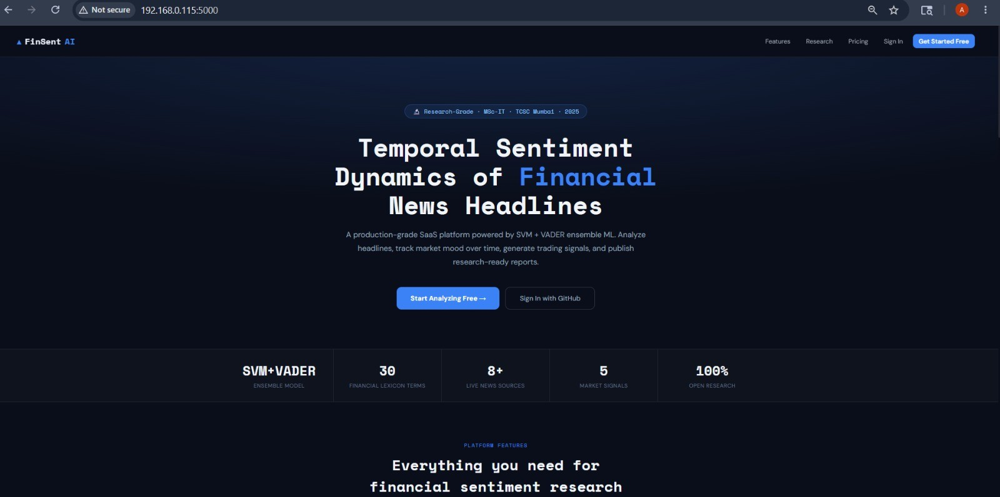

# FinSentAI

**AI-powered financial sentiment analysis and market intelligence platform.**
Turns financial news headlines and price movement into explainable market signals.

> 🔒 **This is a showcase repository.** The source code lives in a private repository. This page documents what the product does, how it is designed, and what I learned building it. Happy to walk through the code or a live demo on request.

> ⚠️ Research / educational project. Signals are informational only and are not financial advice.

[**🚀 Live Demo**](https://finsentai.onrender.com/) · [**LinkedIn**](https://linkedin.com/in/ratnesh-pathak-087466279) · [**Email**](mailto:pathakratnesh03@gmail.com)

*Hosted on a free tier: the first load may take up to a minute while the app wakes up.*

---

## 🖥️ Preview

*Financial intelligence dashboard: sentiment analysis, market context, analytics and insights.*

---

## 💡 The Problem

Financial news moves faster than anyone can read it, and a headline's tone only means something when it is read alongside what the price is doing. FinSentAI classifies the sentiment of financial headlines and combines it with price direction to produce signals that are easy to interpret and explain.

## ✨ What It Does

| Area | Capability |
|---|---|
| 🧠 **Sentiment Analysis** | Positive / Negative / Neutral classification using an SVM + VADER ensemble |
| 📈 **Market Intelligence** | Stock quotes, price history, watchlists and sentiment-vs-price signals |
| 📰 **News Intelligence** | Multi-source financial news ingestion with automatic fallback modes |
| 🚨 **Alerts** | Keyword-based sentiment alerts and scanning workflows |
| 🤖 **AI Assistant** | Optional LLM-powered finance assistant with a local ML fallback |
| 📊 **Analytics** | Sentiment distribution, trends, heatmaps and stock comparison |
| 📄 **Reporting** | Report builder with downloadable analysis reports |
| 🔌 **REST API** | Authenticated single and batch prediction, history and statistics endpoints |
| 🔐 **Auth & Roles** | User accounts, API keys, admin workflows and optional OAuth |

## 🏗️ How It Works

**Sentiment pipeline**

1. Clean and normalize the headline
2. Score it with VADER (extended with a finance-specific lexicon)
3. Run a TF-IDF + linear SVM classifier
4. Combine both outputs and adjust confidence based on model agreement
5. Extract finance-related keywords
6. Store the result for historical analytics

**Market signal logic**

| Sentiment | Price movement | Signal |
|---|---|---|
| Positive | Rising | BUY |
| Negative | Falling | SELL |
| Positive | Falling | WATCH |
| Negative | Rising | CAUTION |
| Neutral | Any | HOLD |

These are research signals that demonstrate the logic, not trading recommendations.

## 🧰 Tech Stack

**Backend:** Python, Flask, SQLAlchemy, Flask-Login
**ML / NLP:** scikit-learn (TF-IDF, Linear SVM, GridSearchCV), VADER
**Data sources:** NewsAPI, GNews, RSS, Alpha Vantage
**Frontend:** Jinja templates, HTML, CSS, JavaScript
**DevOps & quality:** Docker, Docker Compose, Gunicorn, Pytest, GitHub Actions

## 🔬 Model Notes (Honest Version)

- Training workflow: stratified 5-fold cross-validation with hyperparameter search over TF-IDF configurations
- The included model was trained on a small demonstration set of 100 labeled headlines, with cross-validation accuracy around 52%
- That is deliberate prototype scale. The platform around the model (pipeline, API, analytics, deployment) is the main contribution, and the model is designed to be swapped out
- **Next step:** a much larger labeled dataset, a held-out benchmark, and evaluation of finance-specific transformer models such as FinBERT

## 🧠 Engineering Highlights

- End-to-end system rather than a standalone notebook: model, data ingestion, backend, auth, API, dashboard, tests and containerized deployment
- Graceful degradation: the app stays usable when an external API key is missing or a provider fails
- Explainability built in: confidence scores, keyword extraction and a model-agreement check, so outputs can be inspected rather than trusted blindly
- Automated tests covering predictions, API authentication, batch limits and login flows

## 🗺️ Roadmap

- [ ] Larger, rebalanced training dataset and held-out benchmark
- [ ] FinBERT-style model evaluation
- [ ] Model versioning and experiment tracking
- [ ] Portfolio-level analytics
- [ ] OpenAPI documentation for the REST API

## 👨‍💻 Author

**Ratnesh Pathak**
M.Sc. Information Technology · AI / ML Engineer · Founder, Team Ignites

GitHub: [@RatneshPathak](https://github.com/RatneshPathak) · LinkedIn: [Ratnesh Pathak](https://linkedin.com/in/ratnesh-pathak-087466279) · Email: pathakratnesh03@gmail.com

---

© Ratnesh Pathak. All rights reserved. The text and images in this repository may not be reused without permission.
